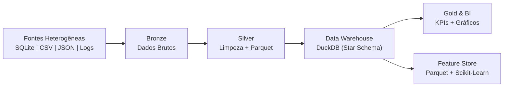

# [Nome do Projeto — ex: Pipeline de Dados & Data Warehouse — CajuTech E-commerce]


> **[Resumo em 2 linhas]:** Pipeline de Engenharia de Dados ponta a ponta que integra 4 fontes heterogêneas (SQLite, CSV, JSON e logs textuais) em uma arquitetura Medallion (Bronze, Silver, Gold), modela um Data Warehouse Star Schema em DuckDB e disponibiliza dados para BI e Machine Learning via Feature Store em Parquet.

---

## 1. Contexto e Problema de Negócio

Descreva brevemente o cenário real ou simulado que o projeto resolve:
- **Qual empresa/domínio está sendo analisado?** *(Ex.: e-commerce de eletrônicos com crescimento acelerado)*
- **Quais dores existiam?** *(Ex.: dados espalhados em sistemas legados, planilhas com sujeira, dificuldade de gerar KPIs confiáveis e ausência de base estruturada para ML)*
- **Quais perguntas de negócio o projeto responde?**
  1. [Pergunta 1 — ex.: Qual categoria de produto gera maior faturamento líquido?]
  2. [Pergunta 2 — ex.: Qual transportadora tem maior taxa de atraso/extravio?]
  3. [Pergunta 3 — ex.: Como identificar clientes de alto valor com base no histórico de compras?]

---

## 2. Arquitetura da Solução

> *Dica: mantenha o diagrama Mermaid abaixo (renderiza nativamente no GitHub) ou substitua por uma imagem salva em `assets/arquitetura.png`.*



### Decisões Arquiteturais
- **Arquitetura Medallion (Bronze/Silver/Gold):** separa dados brutos (rastreabilidade) de dados tratados e agregados.
- **Formato Parquet (PyArrow):** escolhido na camada Silver/Gold/Feature Store pela compressão colunar e leitura seletiva de colunas.
- **DuckDB + Star Schema:** permite consultas OLAP rápidas em ambiente local com modelagem dimensional (`fato_vendas` + dimensões).
- **Feature Store Offline:** desacopla o cálculo de *features* (RFM) do treinamento do modelo de Machine Learning.

---

## 3. Fontes de Dados e Desafios de Heterogeneidade

| Fonte | Formato | Principais Desafios Tratados |
| :--- | :--- | :--- |
| `crm_clientes.db` | SQLite | Espaços extras, padronização de UF/planos, tratamento de e-mails nulos |
| `vendas_brutas.csv` | CSV | Remoção de duplicatas, datas em formatos mistos, filtros de quantidades/preços inválidos |
| `api_produtos.json` | JSON aninhado | *Flattening* de subobjetos (`produto`, `categoria`, `fornecedor`, `pricing`) |
| `logs_entregas.txt` | Texto / Log | Parsing de linhas semi-estruturadas (`chave=valor`) e descarte de linhas de sistema |

---

## 4. Stack Tecnológica

- **Linguagem:** Python 3.x
- **Manipulação e Armazenamento:** Pandas, PyArrow (Parquet), SQLite3
- **Data Warehouse / OLAP:** DuckDB (SQL)
- **Visualização:** Matplotlib / Seaborn
- **Machine Learning:** Scikit-Learn (`Pipeline`, `StandardScaler`, `LogisticRegression`)

---

## 5. Estrutura do Repositório

```text
nome-do-repositorio/
├── assets/                    # Diagramas e gráficos exportados para o README
├── data/
│   ├── raw/                   # Fontes heterogêneas de entrada
│   ├── datalake/              # Camadas bronze/, silver/ e gold/
│   ├── dw/                    # Banco analítico DuckDB (ignorado ou amostra)
│   └── feature_store/         # Tabelas de features em Parquet
├── notebooks/                 # Notebooks da pipeline (ou scripts em src/)
├── docs/                      # Dicionário de dados e notas técnicas
├── requirements.txt           # Dependências do projeto
└── README.md
```

---

## 6. Como Executar o Projeto

```bash
# 1. Clone o repositório
git clone https://github.com/SEU-USUARIO/SEU-REPOSITORIO.git
cd SEU-REPOSITORIO

# 2. Crie e ative o ambiente virtual
python -m venv .venv
# Windows: .\.venv\Scripts\Activate.ps1 | Linux/macOS: source .venv/bin/activate

# 3. Instale as dependências
pip install -r requirements.txt

# 4. Execute o notebook ou script principal
jupyter lab
```

---

## 7. Principais Resultados e Insights

### Analytics / BI
- **Insight 1:** *[Ex.: A categoria Computadores representou XX% do faturamento líquido total...]*
- **Insight 2:** *[Ex.: A transportadora X apresentou taxa de atraso de YY%...]*

*(Opcional: insira aqui um print de gráfico salvo em `assets/grafico_faturamento.png`)*
```markdown

```

### Qualidade de Dados e Performance
- **Redução de armazenamento:** conversão de CSV para Parquet reduziu o tamanho em disco em **~XX%**.
- **Saneamento:** foram removidas **XX linhas duplicadas** e **YY registros inválidos**.

### Machine Learning (Feature Store)
- **Features criadas:** `total_compras`, `gasto_total`, `ticket_medio`, `recencia_dias`, `taxa_cancelamento`, `prazo_medio_entrega`.
- **Modelo:** Regressão Logística com `StandardScaler` atingiu **XX% de acurácia** na classificação de clientes de alto valor.

---

## 8. Próximos Passos (Melhorias Futuras)

- [ ] Automatizar testes de qualidade de dados com `pytest` ou Great Expectations.
- [ ] Orquestrar a pipeline com Airflow, Prefect ou Dagster.
- [ ] Containerizar a execução com Docker.
- [ ] Conectar a camada Gold a um dashboard interativo (Power BI, Metabase ou Streamlit).

---

## 9. Autor

**[Seu Nome Completo]**
- LinkedIn: [linkedin.com/in/seu-perfil](https://linkedin.com/in/seu-perfil)
- GitHub: [github.com/seu-usuario](https://github.com/seu-usuario)
- E-mail: seu.email@exemplo.com

---
*Projeto desenvolvido originalmente durante o workshop de Introdução à Engenharia de Dados & Data Warehousing (LADATA / XII SEMAC) e expandido para portfólio pessoal.*
