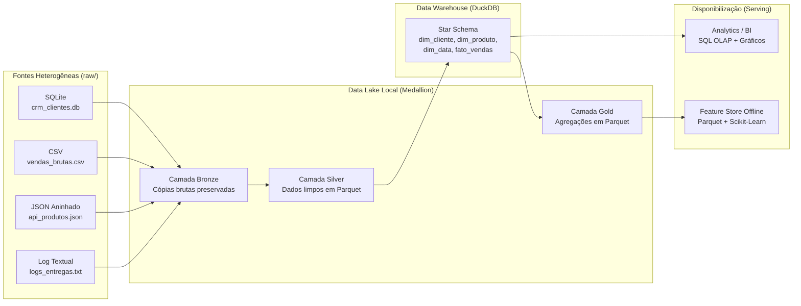

# Projeto Prático (Dia 3) — Pipeline Ponta a Ponta da CajuTech

> **Dados do projeto:** [`data/projeto_dia_03/raw/`](../data/projeto_dia_03/raw/)

---

## 1. Storytelling (Roteiro para Apresentação em Slides)

### Slide 1 — O Cenário: O Crescimento da CajuTech
A **CajuTech** é um e-commerce sergipano de eletrônicos, periféricos e acessórios de tecnologia. No último ano, a empresa triplicou o volume de pedidos e passou a atender clientes em todo o Nordeste. O que antes cabia em uma única planilha agora está espalhado em diferentes sistemas que não conversam entre si.

### Slide 2 — A Dor do Negócio
A diretoria convocou uma reunião de emergência com 4 perguntas estratégicas que ninguém consegue responder com confiança hoje:
1. **Financeiro/Comercial:** Quais categorias de produtos mais geram faturamento líquido e qual a evolução mensal das vendas?
2. **Operações/Logística:** Qual transportadora apresenta maior taxa de atrasos e extravios?
3. **Relacionamento (CRM):** Qual a taxa de cancelamento e quais clientes concentram maior receita?
4. **Ciência de Dados:** Conseguimos gerar uma base histórica de comportamento de compra (*Feature Store*) para prever quais clientes têm perfil de alto valor/recorrência?

### Slide 3 — O Caos da Heterogeneidade dos Dados
Ao investigar a empresa, você descobre que os dados existem, mas estão fragmentados em **4 fontes heterogêneas** — formatos diferentes, esquemas incompatíveis e problemas reais de qualidade:
- **CRM legado** em banco relacional (**SQLite**), com nomes com espaços extras, siglas de estados em maiúsculas/minúsculas misturadas e e-mails ausentes.
- **ERP de vendas** exportado em **CSV**, contendo linhas duplicadas, datas em dois formatos (`YYYY-MM-DD` e `DD/MM/YYYY`), quantidades negativas/nulas e status não padronizados.
- **API de catálogo de produtos** em **JSON aninhado**, onde categoria, fornecedor e preço ficam em subobjetos distintos.
- **Sistema de logística** que gera apenas um **arquivo texto de logs (`.txt`)** semi-estruturado com linhas de sistema (`SYSTEM`) misturadas a eventos de entrega (`INFO`, `WARN`, `ERROR`).

### Slide 4 — A Sua Missão Hoje
Você foi contratado(a) como **Engenheiro(a) de Dados** da CajuTech. Seu objetivo é construir, em **2h30**, uma pipeline completa de Engenharia de Dados aplicando as **4 etapas do ciclo de vida** vistas no workshop:
1. **Ingestão (Bronze)** → 2. **Armazenamento & Limpeza (Silver)** → 3. **Transformação & Star Schema (DW / Gold)** → 4. **Serving (BI + Feature Store para ML)**.

---

## 2. Arquitetura Esperada da Solução

---

## 3. Inventário das Fontes de Dados

Todos os arquivos de entrada já estão prontos em [`data/projeto_dia_03/raw/`](../data/projeto_dia_03/raw/):

| Arquivo | Formato | Origem Simulada | Volume | Problemas de Qualidade / Heterogeneidade |
| :--- | :--- | :--- | :---: | :--- |
| `crm_clientes.db` | SQLite (`.db`) | Sistema de CRM (tabela `clientes`) | 80 registros | Espaços extras em `nome`/`cidade`, `estado` e `plano` com caixa mista (`se`/`SE`, `basico`/`PLUS`), `email` nulo em parte dos clientes |
| `vendas_brutas.csv` | CSV (`.csv`) | Exportação do ERP de vendas | 350 linhas | 10 linhas duplicadas exatas, datas mistas (`YYYY-MM-DD` e `DD/MM/YYYY`), `quantidade` negativa (`-1`) ou nula, `preco_unitario` nulo, `status` com espaços/caixa mista |
| `api_produtos.json` | JSON (`.json`) | Payload de API REST de catálogo | 18 produtos | Estrutura aninhada (`items[].produto`, `categoria`, `fornecedor`, `pricing`) que precisa ser achatada (*flattening*) |
| `logs_entregas.txt` | Texto (`.txt`) | Logs do serviço de logística | 276 linhas | Comentários (`#`), linhas de controle (`SYSTEM`) e eventos no formato `timestamp \| NIVEL \| chave=valor` (`INFO`, `WARN`, `ERROR`) |

---

## 4. Objetivos Específicos por Etapa (Cronograma de 2h30)

Sugestão de pasta de saída para o aluno durante a execução: `data/projeto_dia_03/datalake/{bronze,silver,gold}`, `data/projeto_dia_03/dw/cajutech_dw.duckdb` e `data/projeto_dia_03/feature_store/`.

### Etapa 1 — Ingestão & Camada Bronze (~25 min)
**Objetivo:** Conectar-se às 4 fontes heterogêneas e centralizar os dados brutos sem perda de informação.
- Ler a tabela `clientes` do banco SQLite `crm_clientes.db` via `sqlite3` + Pandas.
- Ler `vendas_brutas.csv` via Pandas.
- Ler `api_produtos.json` via `json` e extrair a lista `items` (mantendo a estrutura bruta ou convertendo com `pd.json_normalize`).
- Ler `logs_entregas.txt` linha a linha em Python, filtrando apenas linhas de eventos de entrega (`venda_id=`) e extraindo `timestamp`, `nivel`, `venda_id`, `status_entrega`, `prazo_dias` e `transportadora`.
- Salvar os 4 conjuntos na camada **`bronze/`** preservando os dados originais.

### Etapa 2 — Armazenamento, Limpeza & Camada Silver (~30 min)
**Objetivo:** Padronizar esquemas, tratar sujeiras e armazenar em formato colunar otimizado (**Parquet**).
- **Clientes:** remover espaços extras (`strip()`), padronizar `nome` (Title Case), `estado` (UPPER) e `plano` (Title Case); tratar `email` nulo (ex.: `"nao_informado"`).
- **Vendas:** remover duplicatas exatas (`drop_duplicates`); descartar registros com `quantidade <= 0`, `quantidade` nula ou `preco_unitario` nulo; padronizar `status` em minúsculas sem espaços; converter `data_venda` tratando os dois formatos (`YYYY-MM-DD` e `DD/MM/YYYY`); calcular `valor_liquido = (quantidade * preco_unitario) - desconto`.
- **Produtos:** achatar o JSON em colunas planas (`id_produto`, `nome_produto`, `categoria`, `fornecedor`, `pais_fornecedor`, `preco_tabela`).
- **Entregas:** garantir tipagem numérica (`venda_id`, `prazo_dias`) e `datetime` para o timestamp.
- Salvar as 4 tabelas limpas em **Parquet** na camada **`silver/`** e comparar o tamanho total em disco (CSV/raw vs Parquet/silver).

### Etapa 3 — Transformação, Data Warehouse & Star Schema (~35 min)
**Objetivo:** Construir o modelo dimensional no **DuckDB** e materializar a camada **Gold**.
- Criar/conectar ao banco `cajutech_dw.duckdb` no DuckDB.
- Modelar e criar o **Star Schema** a partir dos Parquets da camada Silver:
  - `dim_cliente` (`id_cliente`, `nome`, `cidade`, `estado`, `plano`, `data_cadastro`)
  - `dim_produto` (`id_produto`, `nome_produto`, `categoria`, `fornecedor`, `pais_fornecedor`, `preco_tabela`)
  - `dim_data` (`id_data`, `data`, `ano`, `mes`, `dia`, `trimestre`)
  - `fato_vendas` (`id_venda`, `id_cliente`, `id_produto`, `id_data`, `quantidade`, `preco_unitario`, `desconto`, `valor_liquido`, `status`, `status_entrega`, `prazo_dias`, `transportadora`)
- Exportar pelo menos uma tabela agregada (ex.: faturamento mensal por categoria) em Parquet na camada **`gold/`**.

### Etapa 4 — Serving: Analytics (BI) & Machine Learning (Feature Store) (~30 min)
**Objetivo:** Disponibilizar os dados para tomada de decisão de negócio e para consumo de ML.
- **Frente A — Analytics / BI:** executar consultas SQL OLAP no DuckDB para responder às perguntas da diretoria:
  1. Faturamento líquido total e ticket médio por **categoria** de produto.
  2. Evolução mensal do faturamento (com gráfico de linha ou barras no `matplotlib`).
  3. Taxa de entregas `ATRASADO` e `EXTRAVIADO` por **transportadora**.
  4. Top 5 clientes por faturamento líquido (considerando apenas vendas `concluida`).
- **Frente B — Ciência de Dados / ML (Feature Store):**
  1. Criar via SQL no DuckDB uma tabela de *features* por cliente (`fs_clientes_cajutech`) com agregações históricas: `total_compras`, `gasto_total`, `ticket_medio`, `recencia_dias`, `taxa_cancelamento` e `prazo_medio_entrega`.
  2. Exportar a Feature Store em Parquet (`feature_store/fs_clientes_cajutech.parquet`).
  3. Carregar apenas as colunas necessárias no Pandas e treinar um modelo simples do **Scikit-Learn** (ex.: `Pipeline(StandardScaler + LogisticRegression)`) para classificar clientes de **alto valor** (ex.: `gasto_total` acima da mediana ou recorrência `>= 4` compras), exibindo acurácia e matriz de confusão.

---

## 5. Checklist de Conclusão

- [ ] As 4 fontes heterogêneas foram ingeridas sem erro e salvas na camada `bronze/`.
- [ ] Duplicatas, nulos, datas mistas, JSON aninhado e logs textuais foram tratados e salvos em Parquet na camada `silver/`.
- [ ] O Data Warehouse `cajutech_dw.duckdb` possui as tabelas do Star Schema (`dim_cliente`, `dim_produto`, `dim_data`, `fato_vendas`).
- [ ] As 4 perguntas de negócio da diretoria foram respondidas com SQL + pelo menos 1 gráfico.
- [ ] A Feature Store foi exportada em Parquet e consumida por um modelo do Scikit-Learn.

### Desafios Bônus (para quem terminar antes)
1. **Testes de Qualidade de Dados:** adicionar `assert` automatizados validando unicidade de `id_venda` na `fato_vendas`, ausência de valores negativos em `valor_liquido` e integridade referencial entre fato e dimensões.
2. **Modularização:** mover o código de ingestão/limpeza do notebook para scripts Python (`.py`) reutilizáveis em uma pasta `src/`.
3. **Publicação no Portfólio:** seguir o [Guia de Portfólio no GitHub](apendice/guia-portfolio-github.md) e o [Template de README](apendice/readme-template.md) para publicar o projeto no seu GitHub pessoal.
