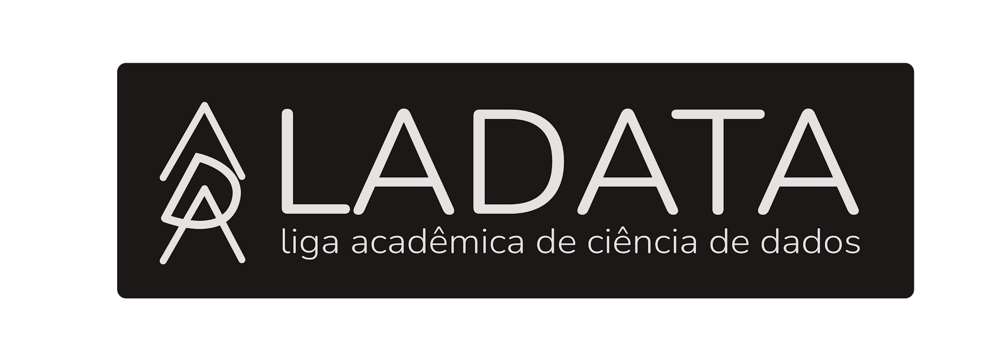

# XII SEMAC — Introdução à Engenharia de Dados & Data Warehousing

Repositório oficial do workshop **Introdução à Engenharia de Dados + Data Warehousing** (LADATA / XII SEMAC), estruturado ao longo de 3 dias de aulas teóricas, demonstrações práticas em notebooks e um projeto prático final.

---

## Estrutura do Repositório

```text
XII-SEMAC-ENGENHARIA-DADOS-DATA-WAREHOUSING/
├── assets/                                # Imagens e identidade visual do workshop
│   └── ladata-banner.png
├── docs/                                  # Plano de trabalho, entregáveis e materiais de apoio
│   ├── proposta_trabalho.md
│   ├── entregaveis.md
│   └── apendice/
│       ├── quality-data-tests.md
│       └── readme-template.md
├── data/                                  # Bases de dados, Data Lake, DW e Feature Store por módulo
│   ├── README.md
│   ├── modulo_01/                         # Ingestão (arquivos de aula e exercícios)
│   ├── modulo_02/                         # Comparativo CSV/Parquet, Data Lake (Bronze/Silver/Gold) e exercícios
│   ├── modulo_03/                         # ETL/ELT, vendas brutas/tratadas e Data Warehouse (DuckDB)
│   └── modulo_04/                         # Feature Store (offline) em Parquet e CSV
├── notebooks/
│   ├── dia_02/
│   │   ├── aulas/                         # Notebooks de demonstração guiada
│   │   │   ├── modulo_01_ingestion.ipynb
│   │   │   ├── modulo_02_storage_dw_dl.ipynb
│   │   │   ├── modulo_03_transformation_etl_elt.ipynb
│   │   │   └── modulo_04_serving_analytics_and_ml.ipynb
│   │   └── exercicios/                    # Cadernos de exercícios práticos
│   │       ├── modulo_02_exercicios.ipynb
│   │       ├── modulo_03_exercicios.ipynb
│   │       └── modulo_04_exercicios.ipynb
│   └── dia_03/                            # Projeto prático integrador
│       └── README.md
├── requirements.txt                       # Dependências Python do ambiente
└── README.md
```

---

## Conteúdo Prático (Dia 2)

| Módulo | Tema | Aula | Exercícios | Dados |
| :---: | :--- | :--- | :--- | :--- |
| **01** | Ingestão de Dados (arquivos, APIs, SQLite) | [modulo_01_ingestion.ipynb](notebooks/dia_02/aulas/modulo_01_ingestion.ipynb) | Inclusos no notebook da aula | [`data/modulo_01/`](data/modulo_01/) |
| **02** | Armazenamento, Data Warehouse e Data Lake | [modulo_02_storage_dw_dl.ipynb](notebooks/dia_02/aulas/modulo_02_storage_dw_dl.ipynb) | [modulo_02_exercicios.ipynb](notebooks/dia_02/exercicios/modulo_02_exercicios.ipynb) | [`data/modulo_02/`](data/modulo_02/) |
| **03** | Transformação, ETL/ELT, OLAP e Star Schema | [modulo_03_transformation_etl_elt.ipynb](notebooks/dia_02/aulas/modulo_03_transformation_etl_elt.ipynb) | [modulo_03_exercicios.ipynb](notebooks/dia_02/exercicios/modulo_03_exercicios.ipynb) | [`data/modulo_03/`](data/modulo_03/) |
| **04** | Serving, Analytics e Machine Learning (Feature Store) | [modulo_04_serving_analytics_and_ml.ipynb](notebooks/dia_02/aulas/modulo_04_serving_analytics_and_ml.ipynb) | [modulo_04_exercicios.ipynb](notebooks/dia_02/exercicios/modulo_04_exercicios.ipynb) | [`data/modulo_04/`](data/modulo_04/) |

---

## Como Executar Localmente

1. Crie e ative um ambiente virtual Python:
   ```bash
   python -m venv .venv
   # Windows (PowerShell)
   .\.venv\Scripts\Activate.ps1
   # Linux / macOS
   source .venv/bin/activate
   ```
2. Instale as dependências:
   ```bash
   pip install -r requirements.txt
   ```
3. Abra os notebooks em `notebooks/dia_02/aulas/` ou `notebooks/dia_02/exercicios/` no VS Code ou Jupyter Lab. Todos os caminhos relativos apontam automaticamente para `data/`.

---

## Documentação Adicional

- [Proposta de Trabalho e Ementa](docs/proposta_trabalho.md)
- [Entregáveis por Dia](docs/entregaveis.md)
- [Organização dos Dados](data/README.md)
